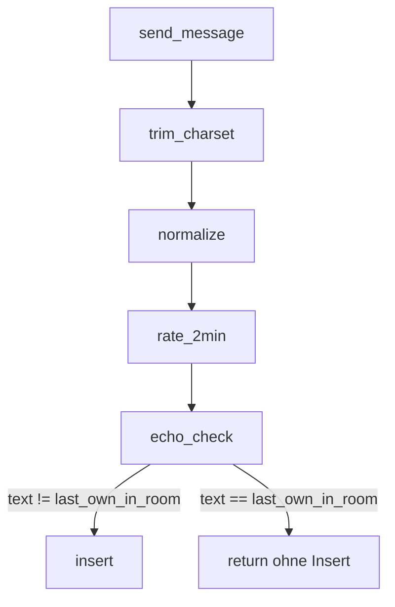

# Echo-Schutz (Duplicate-Detection)

## Ziel

Bots, die **denselben Text wiederholt** posten, bremsen, ohne Identity-Langzeit-Quotas. Regel: **kein zweites Mal derselbe Inhalt** direkt hinter der **eigenen letzten Nachricht im aktuellen Raum**.

| Aspekt | Vorgabe |
|--------|---------|
| Vergleich | **Zeichenfolge** auf `normalized_text` (nach Charset + `normalize_allowed_text`, gleich wie Insert) |
| Scope | `ctx.sender` + `clean_url` (Raum) |
| Verhalten | Stilles `return` in `send_message` (wie Rate-Limit, Charset) |
| Hash | **Nicht nötig** für MVP (kurze Strings); optional später, wenn Längenlimits kommen |

**Wirksamkeit:** Stoppt „10× hintereinander derselbe Text“ bereits beim **2. Versuch** (1. ist gespeichert, 2. identisch → block). Identity-Rotation umgeht es weiterhin, akzeptabel; kombiniert mit **2/Min** und Charset.

**Nicht betroffen:** `join_room`, fremde Nachrichten zitieren (eigene letzte war anders), „a“ → „b“ → „a“.



---

## 1. Server, [`server/src/lib.rs`](server/src/lib.rs)

### 1.1 State-Tabelle (kein Scan)

Tabelle `sender_room_state` (siehe [server-query-patterns.md](../../docs/requirements/server-query-patterns.md)):

- PK oder Unique: `(sender_identity, url)` (z. B. zusammengesetzter Schlüssel / zwei Felder + Index)
- Felder: `last_text: String` (normalisiert), optional `last_message_id`

**Vor** `insert`: `find` → wenn `last_text == normalized_text` → `return`.

**Nach** `insert`: `insert` oder `update` der Zeile mit neuem `last_text`.

**Nicht:** `chat_message.iter()` oder „letzte Zeile durchsuchen“.

### 1.2 Check in `send_message`

Nach Username-Normalisierung, `ensure_purge_job`, **nach** 2/Min-Check, **vor** `insert`:

```rust
if sender_room_state_last_text_matches(ctx, ctx.sender, &clean_url, &normalized_text) {
    return;
}
```

### 1.3 Modul-Kommentar

Zeile oben: `duplicate-detection.md` / `security-list.md §5`.

Schema-Change (`sender_room_state`) → `npm run codegen:stdb` in `extension/`.

---

## 2. Extension (optional, geringer Aufwand, empfohlen)

Parallele zu Rate-Limit: Nutzer sieht selten „Senden ins Leere“.

### 2.1 Logik

Neues kleines Modul [`extension/src/lib/echo-guard.ts`](extension/src/lib/echo-guard.ts) (kein `$state` nötig):

- `lastOwnMessageTextInRoom(messages, identityHex, roomUrl): string | null`, aus Subscription-State, `senderIdentity.toHexString()`, sortiert nach `id` / `createdAt`
- `isEchoDuplicate(preparedText, lastOwn): boolean`, `preparedText.length > 0 && lastOwn !== null && preparedText === lastOwn`

`preparedText` = `prepareMessageForSend(...)` (gleiche Normalisierung wie Server).

### 2.2 [`extension/src/App.svelte`](extension/src/App.svelte)

- `$derived` `lastOwnText` aus `messages` + `identity` + `urlState.current`
- `echoBlocked = isEchoDuplicate(prepareMessageForSend(newMessage), lastOwnText)`
- `canSendMessage`: `!echoBlocked && !rateLimited && …`
- `handleSend`: früh return wenn `echoBlocked`
- Placeholder/Hinweis: z. B. *„Gleicher Text wie deine letzte Nachricht“*; Footer: *„Keine Wiederholung deiner letzten Nachricht in diesem Raum.“*

### 2.3 [`extension/src/lib/spacetime.svelte.ts`](extension/src/lib/spacetime.svelte.ts)

Kein Pflicht-Change; optional **kein** `recordSend()` bei rein clientseitig blockiertem Echo (Rate-Limit bleibt unberührt).

**Hinweis:** `bubble own` nutzt heute `senderName`, für Echo **Identity** verwenden (wie in [delete-messages.md](docs/requirements/delete-messages.md) geplant).

---

## 3. Dokumentation

| Datei | Inhalt |
|-------|--------|
| **Neu:** [`docs/requirements/duplicate-detection.md`](docs/requirements/duplicate-detection.md) | Ziel, Regeln, Scope Raum+Sender, Server-Stelle, Extension-UX, Abgrenzung zu §1/§7/§10, Akzeptanz + manuelle Tests |
| [`docs/requirements/security-list.md`](docs/requirements/security-list.md) | **§5 Echo-Schutz** (Abschnitt 5 war frei): Kurzfassung + Link auf duplicate-detection.md; Umsetzungsliste (neuer Punkt nach Message Content oder vor Delete-Messages); „Stand Implementierung“ nach Go-Live |
| [`docs/requirements/security.md`](docs/requirements/security.md) | Roadmap §8: Einzeiler Echo-Schutz |
| [`docs/kickoff/ideas.md`](docs/kickoff/ideas.md) | Optional Punkt 7 oder Fußnote unter Anti-Spam: Echo-Schutz umgesetzt → Link |
| [`docs/learnings.md`](docs/learnings.md) | Optional 1 Satz unter §10: Echo pro Raum hilft gegen repetitive Bots, nicht gegen Identity-Rotation |

---

## 4. Akzeptanz (manuell)

1. Raum A: „Hallo“ senden → OK. Nochmal „Hallo“ → **keine** neue Zeile.
2. „Hallo“ → „Tschüss“ → „Hallo“ → OK (letzte eigene war „Tschüss“).
3. Anderer Nutzer postet „Hallo“; eigene letzte war „X“ → „Hallo“ → OK.
4. URL B: erster „Hallo“ → OK (anderer Raum).
5. UI: zweiter identischer Versuch disabled + Hinweis (wenn Extension umgesetzt).
6. Regression: 2/Min, Charset, Retention unverändert.

---

## 5. Deploy

1. `cd server && cargo build --target wasm32-unknown-unknown`
2. `spacetime publish wepchat -y`
3. `cd extension && npm run build`

---

## Aufwand

| Teil | Größe |
|------|--------|
| Server (~30–40 Zeilen) | sehr gering |
| `echo-guard.ts` + App.svelte | sehr gering |
| Docs | gering |
