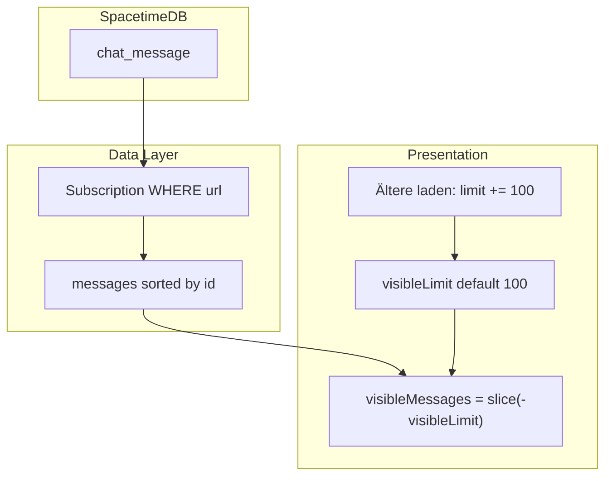

# Umsetzung: Chat-Verlauf paginieren (Client-Fenster)

Spec: [message-history-pagination.md](docs/requirements/message-history-pagination.md)

## Architektur-Entscheidung (revidiert)

**Verworfen** (siehe Review):

| Ansatz | Warum nicht |
|--------|-------------|
| `#[view] message_page(url, before_id, limit)` | Views sind keine parametrisierte RPC; TS-SDK liefert keine Ad-hoc-View-Aufrufe wie REST. |
| Subscription `id >= oldestId` + **Resubscribe** | Snapshot/Live-Overlap, Flackern, doppelte Events bei jedem „Ältere laden“. |
| HTTP SQL + ORDER BY für Seiten | Fragil; Subscriptions ohne ORDER BY/LIMIT; unnötig bei 72h-Retention. |

**Gewählt: Spec §4.2 — Presentation Layer**

- **Data:** eine **statische** Subscription pro URL: `SELECT * FROM chat_message WHERE url = '…'` (wie heute).
- **Cache:** `state.messages` = alle Zeilen des Raums im Client (72h-Bestand, typisch hunderte bis wenige tausend Zeilen).
- **UI:** nur ein **Slice** rendern — `visibleLimit` startet bei 100, „Ältere laden“ → `visibleLimit += 100` (synchron, 0 ms).

**Begründung Retention:** Max. Lebensdauer 72h begrenzt Raumgröße; Render-Optimierung reicht; Echtzeit unten bleibt trivial (`onInsert` → voller Cache, Slice endet automatisch bei neuesten).

---

## 1. Server

**Keine Änderung** an [`server/src/lib.rs`](server/src/lib.rs). Kein Publish/Codegen für dieses Feature.

*(Optional später, separates Ticket: Index `url` / Purge — [server-query-patterns.md](docs/requirements/server-query-patterns.md), nicht Blocker für Pagination.)*

---

## 2. Extension — [`extension/src/lib/message-history.ts`](extension/src/lib/message-history.ts)

Konstante `MESSAGE_PAGE_SIZE = 100`.

Pure functions (unit-testbar):

| Funktion | Zweck |
|----------|--------|
| `visibleMessagesSlice(all, visibleLimit)` | `all` aufsteigend nach `id`; Rückgabe `all.slice(Math.max(0, len - visibleLimit))` |
| `hasOlderMessages(all.length, visibleLimit)` | `all.length > visibleLimit` |
| `nextVisibleLimit(current, pageSize, total)` | `min(current + pageSize, total)` |
| `shouldAutoScrollToBottom(el, thresholdPx)` | Nutzer nahe unterem Rand |

Kein `loadingOlder` (optional kurzes `tick()` nur für Scroll-Anker nach DOM-Update).

---

## 3. Extension — State

In [`spacetime.svelte.ts`](extension/src/lib/spacetime.svelte.ts) oder [`message-history.svelte.ts`](extension/src/lib/message-history.svelte.ts):

- `visibleLimit = $state(100)` — bei **`subscribeToUrl`** (neue URL): zurück auf `100`.
- `messages` bleibt vollständige Liste (bestehende `onInsert`/`onDelete`/`onApplied` Logik).
- Export: `loadOlderVisible()` → `visibleLimit = nextVisibleLimit(...)`, `get visibleLimit`, derived `hasOlder` aus Längen.

**Kein** Resubscribe, **kein** `oldestLoadedId` für die Subscription.

---

## 4. Extension — [`spacetime.svelte.ts`](extension/src/lib/spacetime.svelte.ts)

- `subscribeToUrl`: bei URL-Wechsel `visibleLimit = 100`, `messages = []` wie heute.
- Subscription-SQL **unverändert** (nur `url`).
- `onApplied`: weiter alle Raum-Nachrichten in `state.messages` sortieren.

---

## 5. UI — [`extension/src/App.svelte`](extension/src/App.svelte)

- `$derived visibleMessages = visibleMessagesSlice(spacetimeChat.current.messages, visibleLimit)`.
- `{#each visibleMessages as msg}` statt voller Liste.
- Oben: Button **„Ältere Nachrichten laden“** wenn `hasOlderMessages`; Klick → `loadOlderVisible()` + **Scroll-Anker** (vorher `scrollHeight`/`scrollTop`, nach `tick()` korrigieren).
- **Auto-Scroll:** Raum-Initial: einmal nach unten. Bei `messages.length`-Änderung: nur scrollen wenn `shouldAutoScrollToBottom` (nicht wenn Nutzer oben Historie liest).
- Flag `initialScrollDone` pro Raum-URL vermeiden wiederholtes Springen.

---

## 6. Tests

### 6.1 `node --test`

[`extension/src/lib/message-history.test.ts`](extension/src/lib/message-history.test.ts) + Script in [`package.json`](extension/package.json): `"test:unit": "node --test src/lib/message-history.test.ts"`.

Cases: Slice bei 250/100 → 100 neueste; `hasOlder`; `nextVisibleLimit` cap at total.

### 6.2 Manuell

[message-history-pagination.md §8.1](docs/requirements/message-history-pagination.md) — Ladespinner nicht nötig; Scroll-Anker + Echtzeit unten.

---

## 7. Dokumentation

- [message-history-pagination.md](docs/requirements/message-history-pagination.md): §4.2 als **Implementierungsweg**; §4.1 als „später, nur bei Messung > X Nachrichten/Raum“; Status nach Merge.
- Kurz in Spec: warum kein View/Resubscribe (Verweis auf diesen Plan-Abschnitt).

---

## 8. Bewusst akzeptierte Grenzen

- Netzwerk: weiterhin **voller** Raum-Sync über WebSocket (OK für 72h-Fenster).
- Wenn Räume extrem groß werden: separates Ticket (Index, serverseitige Views/Procedures **nur** nach Bedarf) — nicht vorab.

---

## 9. Nicht in diesem Schritt

- `sql-utils` / HTTP-History (entfällt)
- Echo-Schutz, `send_rate_state`, Server-Indizes
