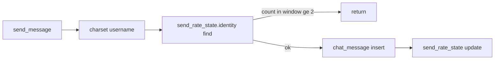

# `send_rate_state` statt `count_recent_messages`

## Ziel

Gleiche **fachliche** Regel ([security-list §1](docs/requirements/security-list.md)): max. **2** Sends pro **60s** gleitendes Fenster, **global pro `ctx.sender`**, stilles `return` in `send_message`. **Kein** `chat_message().iter()` mehr auf dem Send-Pfad.

Extension ([rate-limit.svelte.ts](extension/src/lib/rate-limit.svelte.ts)) **unverändert**.



---

## 1. Schema — [`server/src/lib.rs`](server/src/lib.rs)

Neue Tabelle **`send_rate_state`** (ohne `public` — nur Modul/Reducer, nicht für Client-Subscriptions nötig):

```rust
#[table(name = send_rate_state)]
struct SendRateState {
    #[primary_key]
    identity: Identity,
    /// Älterer der bis zu zwei Sendezeiten im aktuellen Fenster; UNIX_EPOCH = leer
    send_at_1: Timestamp,
    /// Neuerer Send; UNIX_EPOCH = leer
    send_at_2: Timestamp,
}
```

**Sentinel:** `Timestamp::UNIX_EPOCH` = Slot unbenutzt (SpacetimeDB `Timestamp` ist vergleichbar).

---

## 2. Logik (ersetzt `count_recent_messages`)

Extrahieren in testbare Hilfsfunktionen (gleiche Datei oder `rate_window.rs`):

| Funktion | Rolle |
|----------|--------|
| `fn window_start(now: Timestamp) -> Timestamp` | `now - rate_window()` |
| `fn count_sends_in_window(t1, t2, window_start) -> u32` | Zählt `t1`/`t2` wenn `>= window_start` und `!= UNIX_EPOCH` |
| `fn is_rate_limited(ctx, sender) -> bool` | `find(identity)` → `count >= MAX_MESSAGES_PER_WINDOW` |
| `fn record_rate_send(ctx, sender, now)` | Nach erfolgreichem Insert: gültige Timestamps + `now`, sortieren, die **zwei neuesten** in `send_at_1`/`send_at_2` (älter → `send_at_1`) |

**`send_message`:**

```rust
if is_rate_limited(ctx, ctx.sender) {
    return;
}
// insert ...
record_rate_send(ctx, ctx.sender, ctx.timestamp);
```

**Entfernen:** gesamte Funktion `count_recent_messages` und deren `iter()`-Schleife.

**Optional (Hygiene):** In `identity_disconnected` Zeile `send_rate_state` für `ctx.sender` löschen — verhindert tote State-Zeilen; kein Muss für Korrektheit.

---

## 3. Semantik vs. alter Scan

| | Scan (`count_recent_messages`) | `send_rate_state` |
|---|-------------------------------|-------------------|
| Zählt | Zeilen in `chat_message` im Fenster | **Send-Events** (Reducer erfolgreich) |
| Nach geplantem `delete_own_message` | Zähler sinkt mit gelöschter Zeile | Zähler **bleibt** (gewollt für Abuse-Schutz) |

Ein Satz in [server-query-patterns.md](docs/requirements/server-query-patterns.md) §3.1 ergänzen.

---

## 4. Tests

### 4.1 Automatisch — `cargo test` in `server/`

`#[cfg(test)] mod tests` in `lib.rs` (oder kleines `rate_window.rs`):

- `count_sends_in_window`: beide leer → 0; eine im Fenster → 1; zwei im Fenster → 2; eine vor `window_start` → ignoriert
- `merge_after_send` (falls ausgelagert): nach drittem Send im Fenster nur die zwei neuesten behalten

`Timestamp`: `Timestamp::from_micros_since_unix_epoch(n)` (exakte API beim Implementieren aus `spacetimedb::Timestamp` prüfen).

**CI-Hinweis:** In README oder [security-list §1.6](docs/requirements/security-list.md) verlinken: `cd server && cargo test`.

### 4.2 Manuell (Sidepanel)

Bestehende [§1.6 Testideen](docs/requirements/security-list.md#16-testideen-manuell) — unverändert gültig; optional Punkt 5: SQL/Dashboard — nach 2 Sends existiert Zeile in `send_rate_state` für die Identity.

Kein `spacetime call --anonymous` für Rate-Tests (neue Identity pro Call).

---

## 5. Deploy

1. `cd server && cargo build --target wasm32-unknown-unknown`
2. `cargo test` (Host)
3. `spacetime publish wepchat -y`
4. `cd extension && npm run codegen:stdb` (neue Tabelle in Bindings; Extension subscribt sie nicht)

---

## 6. Dokumentation

| Datei | Änderung |
|-------|----------|
| [security-list.md](docs/requirements/security-list.md) §1.2–1.3 | **Ist-Zustand:** `send_rate_state`, kein Scan; §1.5 Akzeptanz Verweis auf Hilfstabelle + `cargo test` |
| [server-query-patterns.md](docs/requirements/server-query-patterns.md) | Tabelle Ist-Zustand: Rate-Limit = Hilfstabelle ✓; Backlog-Punkt 1 streichen/als erledigt |
| [learnings.md](docs/learnings.md) §11 | `count_recent_messages` entfernt; Rate über `send_rate_state` |
| [lib.rs](server/src/lib.rs) Kopfkommentar | `send_rate_state` erwähnen |

---

## 7. Nicht in diesem Schritt

- Indizes auf `chat_message`, Echo `sender_room_state`, Purge-Refactor
- Extension-Code (außer Codegen)
