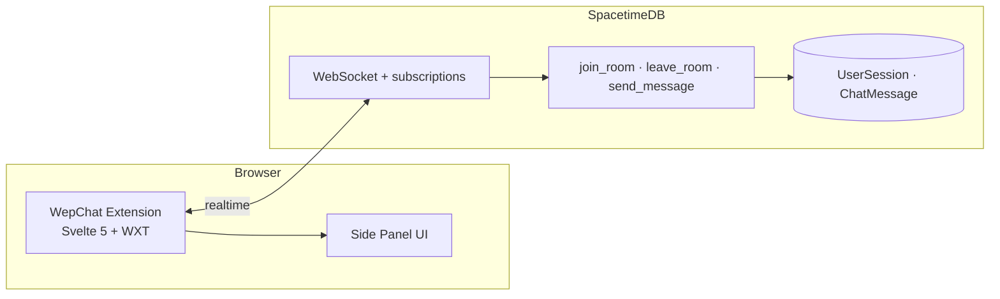

# WepChat

**Chat with everyone on the same page.** WepChat is a cross-browser extension that turns the current URL into a live chat room — with real-time presence so you always see how many people are on that exact page with you.

No account. No social login. Open the side panel and talk.

---

## Why WepChat?

Every day millions of people visit the same product page, article, or docs URL — but they never know it. WepChat adds a lightweight social layer **per URL**:

| | |
|---|---|
| **Same URL → same room** | One chat per normalized page URL |
| **Live presence** | See how many users are on this page right now |
| **Side panel UX** | Chat lives in the browser sidebar; the site stays visible and usable |
| **Privacy-first** | Random pseudonym, local profile storage, URL sanitization before joining |

---

## How it works



1. The extension reads the active tab URL, strips tracking parameters, and joins the matching room.
2. **SpacetimeDB** keeps presence (`UserSession`) and messages (`ChatMessage`) in sync for all subscribers.
3. When you navigate away or disconnect, presence is cleaned up automatically.

---

## Tech stack

| Layer | Stack |
|-------|--------|
| Extension | [WXT](https://wxt.dev/) · [Svelte 5](https://svelte.dev/) · TypeScript · Manifest V3 |
| Realtime backend | [SpacetimeDB](https://spacetimedb.com/) (Rust module → WASM) |
| Web | PHP placeholder for legal/landing pages (`web/`) |

Chrome uses the **Side Panel API**; Firefox uses **Sidebar Action** — one codebase, two builds.

---

## Repository layout

```text
WepChat/
├── extension/     # Browser extension (UI, URL logic, SpacetimeDB client)
├── server/        # SpacetimeDB Rust module (tables + reducers)
├── web/           # Static PHP pages (e.g. imprint, privacy)
└── docs/          # Concept, architecture, setup notes
```

---

## Development

### Prerequisites

- **Node.js** 18+ and npm
- **Rust** toolchain (for the SpacetimeDB module)
- **[SpacetimeDB CLI](https://spacetimedb.com/install)** (`spacetime`)
- Chrome or Firefox for loading unpacked / dev builds

### Extension (local)

```bash
cd extension
npm install
npm run dev          # WXT dev server + test browser
npm run build        # production build → .output/
npm run build:firefox
```

Load the unpacked extension from `extension/.output/chrome-mv3` (or the Firefox artifact after `build:firefox`).

### Backend (publish & regenerate client)

From the repo root:

```bash
cd server
spacetime publish wepchat    # or: spacetime publish --server local wepchat

cd ../extension
spacetime generate --lang typescript --out-dir src/lib/spacetimedb --project-path ../server
```

The extension connects to **SpacetimeDB Maincloud** by default (`wepchat` module). Adjust `SPACETIMEDB_URI` / `MODULE_NAME` in `extension/src/lib/spacetime.svelte.ts` if you use a self-hosted instance.

### Useful docs in this repo

- [Concept & UX](docs/kickoff/konzept.md)
- [Architecture requirements](docs/requirements/architektur.md)
- [Setup walkthrough](docs/kickoff/setup.md)
- [Go-live checklist](docs/kickoff/Live-Inbetriebnahme.md)

---

## Privacy & data

- **No mandatory registration** — identity comes from SpacetimeDB’s connection identity; display name is a local pseudonym.
- **Profile data** stays in `chrome.storage.local` (or Firefox equivalent).
- **URLs are normalized** before room lookup (tracking params removed) to reduce fragmentation and accidental leakage of session tokens in query strings.

---

## Roadmap

- [x] WXT + Svelte 5 side panel shell
- [x] SpacetimeDB schema: presence + chat reducers
- [x] Extension ↔ Maincloud integration
- [ ] Store listing polish, moderation, message retention policy
- [ ] Mobile strategy (PWA / share-sheet) — see [requirements](docs/requirements/general.md)

---

## Contributing

Issues and PRs are welcome on [github.com/enomie/WepChat](https://github.com/enomie/WepChat).

---

**WepChat** — *the web page you’re on is already a crowd; now you can say hello.*
